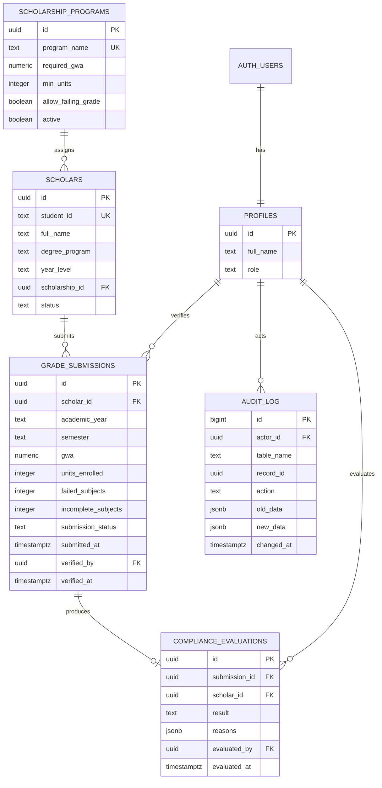

# Data model

`grade_submissions` has a unique constraint over `(scholar_id, academic_year, semester)`. The evaluation records the result and reason list from that verified snapshot. The static prototype derives an evaluation from the latest verified submission at render time; the Supabase schema provides a dedicated table and server-side evaluation function for a deployed workflow.
